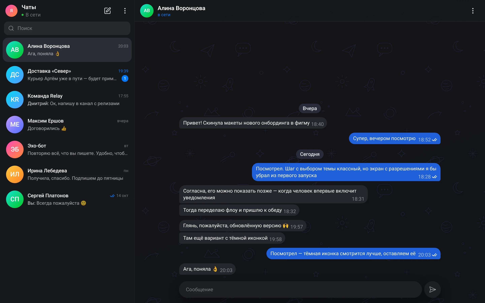
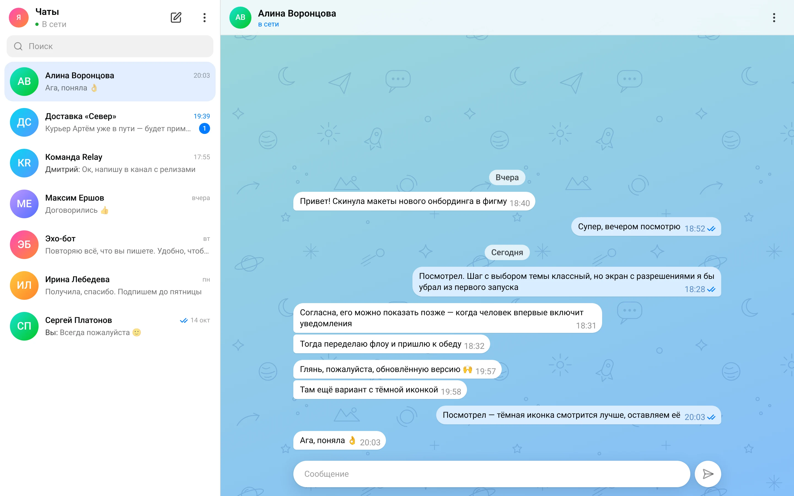
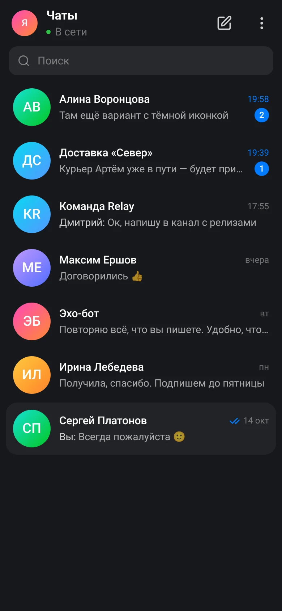
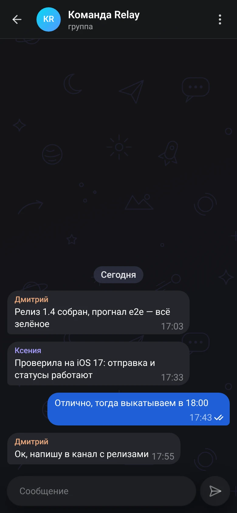
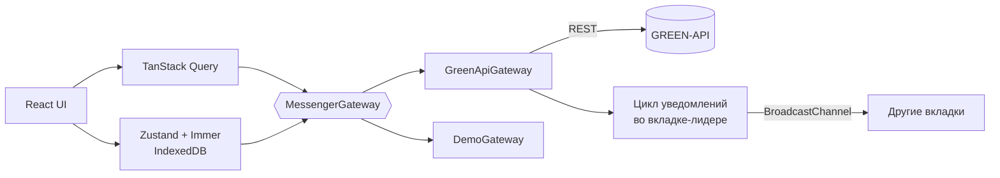

# Relay

Веб-клиент мессенджера [MAX](https://max.ru) на базе [GREEN-API](https://green-api.com/max): вход по данным инстанса, список чатов, переписка в реальном времени и статусы доставки. Интерфейс повторяет логику web.max.ru.



**Демо:** _ссылка на GitHub Pages_. Кнопка «Открыть демо без инстанса» показывает приложение с имитацией собеседников — инстанс не нужен.

## Возможности

- Вход по `idInstance` и `apiTokenInstance` с проверкой состояния инстанса
- Список чатов из MAX с превью последних сообщений и счётчиками непрочитанных
- Новый чат по номеру телефона: номер проверяется через `CheckAccount`, дальше переписка идёт по `chatId`
- Отправка текста через `SendMessage`: сообщение сразу появляется в ленте, статусы меняются «отправляется → отправлено → доставлено → прочитано», неотправленное можно повторить
- Входящие сообщения в реальном времени через HTTP API (`ReceiveNotification` + `DeleteNotification`)
- История чата из `GetChatHistory` с подгрузкой старых сообщений при прокрутке вверх
- Отметка прочтения (`ReadChat`) и индикатор «печатает» у собеседника (`SendTyping`)
- Проверка настроек инстанса: если уведомления выключены или задан `webhookUrl`, приложение покажет это и исправит одной кнопкой
- Тёмная и светлая темы, адаптивная вёрстка, сочетания клавиш (`Ctrl K` — поиск, `Esc` — закрыть чат)

<table>
  <tr>
    <td></td>
    <td width="22%"></td>
    <td width="22%"></td>
  </tr>
</table>

## Как устроено



**Шлюз как граница.** Компоненты работают только с интерфейсом `MessengerGateway` ([`src/gateway/types.ts`](src/gateway/types.ts)). Реализаций две: `GreenApiGateway` и `DemoGateway`. Транспорт через собственный бэкенд (например, вебхуки + WebSocket) добавляется третьей реализацией без изменений в UI.

**Получение сообщений.** Long-polling: `ReceiveNotification` с `receiveTimeout=20`, уведомление удаляется из очереди только после обработки — доставка at-least-once, повторы отсекаются по `idMessage`. При сетевых ошибках — экспоненциальная задержка с джиттером, без сети — ожидание события `online`, на 401/403 цикл останавливается и предлагает войти заново. Код — в [`notification-loop.ts`](src/gateway/green-api/notification-loop.ts).

**Одна очередь — одна вкладка.** У инстанса одна очередь уведомлений. Если опрашивать её из двух вкладок, каждая получит только часть сообщений. Поэтому опрос ведёт одна вкладка-лидер (Web Locks API), а остальные получают события через `BroadcastChannel`. Когда лидер закрывается, его место занимает следующая вкладка ([`tab-sync.ts`](src/gateway/tab-sync.ts)).

**Состояние.** Серверные данные — аккаунт, история, контакты — живут в TanStack Query. Лента чатов — в zustand с immer и сохраняется в IndexedDB отдельно для каждого инстанса, поэтому после перезагрузки переписка на месте сразу. Все ответы API проходят через zod-схемы.

**Отправка и статусы.** Сообщение добавляется в ленту со статусом «отправляется», после ответа `SendMessage` получает `idMessage`, а дальше статусы приходят уведомлениями `outgoingMessageStatus`. Статус не откатывается, если уведомления пришли не по порядку. Если копия `outgoingAPIMessageReceived` пришла раньше ответа `SendMessage`, дубля не будет. Логика покрыта тестами в [`store.test.ts`](src/entities/chat/store.test.ts).

**Лимиты API.** Учтены ограничения частоты запросов GREEN-API: например, `GetChatHistory` — один запрос в секунду, поэтому превью для списка чатов подтягиваются последовательно, а ответ 429 повторяется с задержкой.

**Длинные чаты.** Лента виртуализирована через react-virtuoso, при подгрузке истории сверху позиция прокрутки не прыгает.

## Стек

React 19, TypeScript, Vite, Tailwind CSS 4, Radix UI (компоненты в духе shadcn/ui), TanStack Query, Zustand + Immer, React Hook Form + Zod, react-virtuoso, Vitest, ESLint, GitHub Actions.

## Запуск

```bash
nvm use        # Node 22
npm ci
npm run dev    # http://localhost:5173
```

| Команда             | Что делает                       |
| ------------------- | -------------------------------- |
| `npm run build`     | проверка типов и сборка в `dist` |
| `npm run preview`   | локальный просмотр сборки        |
| `npm test`          | юнит-тесты (Vitest)              |
| `npm run lint`      | ESLint                           |
| `npm run typecheck` | проверка типов                   |

## Подготовка инстанса

1. В [личном кабинете GREEN-API](https://console.green-api.com) создайте инстанс MAX и авторизуйте его по QR-коду.
2. Скопируйте `idInstance` и `apiTokenInstance`. Если `apiUrl` в кабинете отличается от `https://XXXX.api.green-api.com` (первые четыре цифры инстанса), укажите его в поле «Адрес API» на экране входа.
3. Включите уведомления о входящих сообщениях, статусах и сообщениях с телефона, оставьте `webhookUrl` пустым. Если что-то выключено, приложение предложит исправить настройки сразу после входа.

На бесплатном тарифе MAX Developer действует лимит на число собеседников в месяц — при превышении приложение покажет уведомление.

## Деплой

Workflow [`.github/workflows/ci.yml`](.github/workflows/ci.yml) прогоняет линтер, проверку типов и тесты, собирает проект и публикует его на GitHub Pages. В настройках репозитория нужно выбрать **Settings → Pages → Source: GitHub Actions**.

## Структура

```
src/
  app/        провайдеры и корневой компонент
  pages/      экраны входа и мессенджера
  widgets/    сайдбар и окно переписки
  features/   отправка, новый чат, realtime, прочтение, тема, настройки инстанса
  entities/   чат, сообщение, сессия: модели, сторы, запросы, базовые компоненты
  gateway/    контракт шлюза, клиент GREEN-API, демо-шлюз, синхронизация вкладок
  shared/     UI-кит, утилиты, конфигурация
```

## Ограничения

- Отправляются только текстовые сообщения; входящие фото, файлы и голосовые показываются подписью.
- Данные инстанса хранятся в браузере (`localStorage` или `sessionStorage`, если снять «Запомнить»), запросы идут напрямую в GREEN-API. В продакшене токен стоит держать на своём бэкенде.
